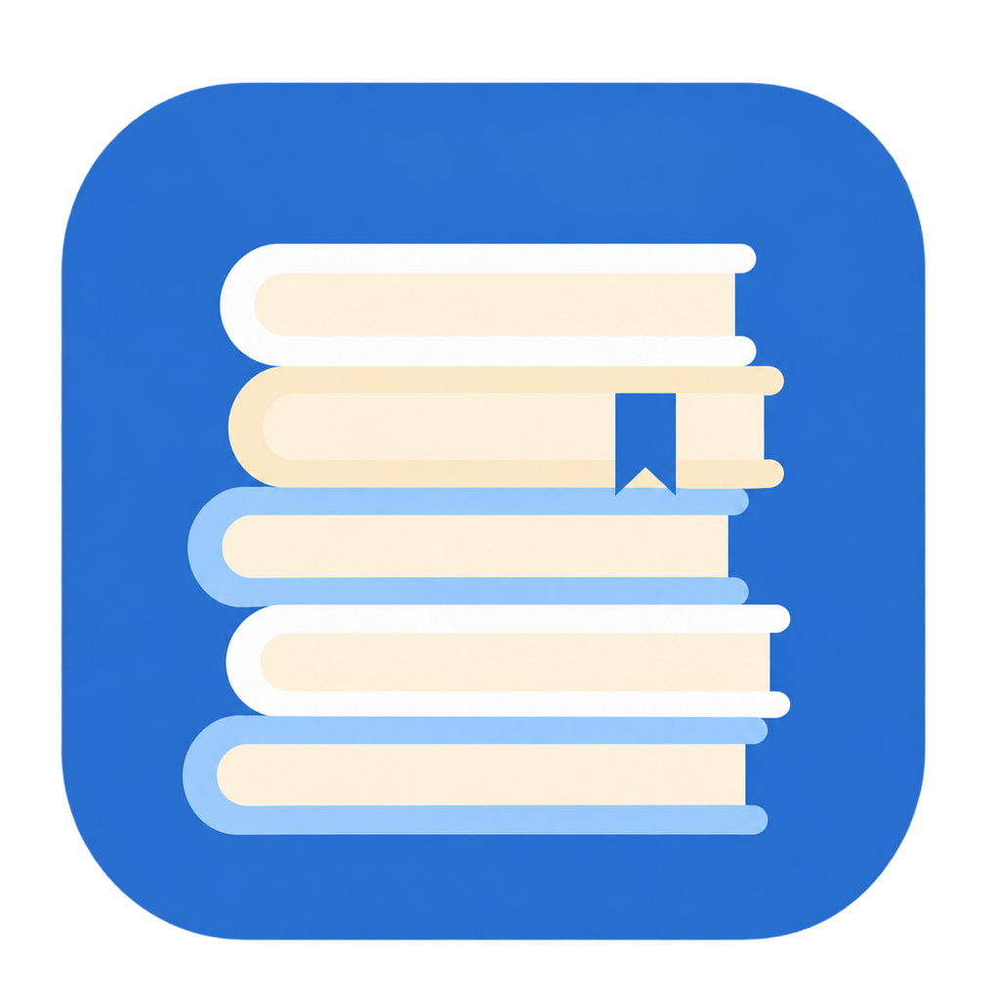
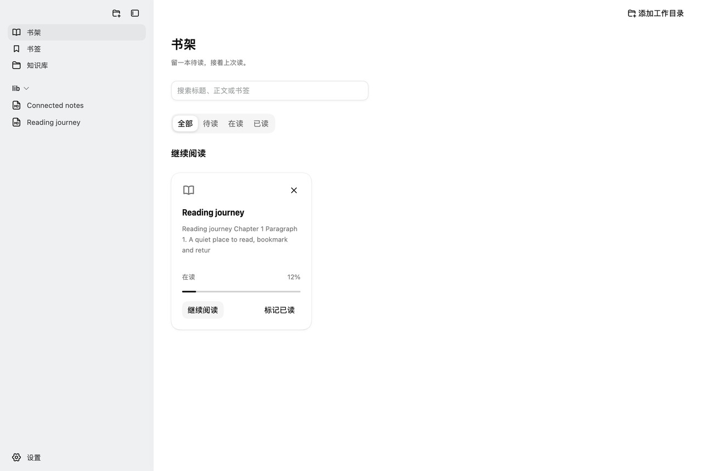
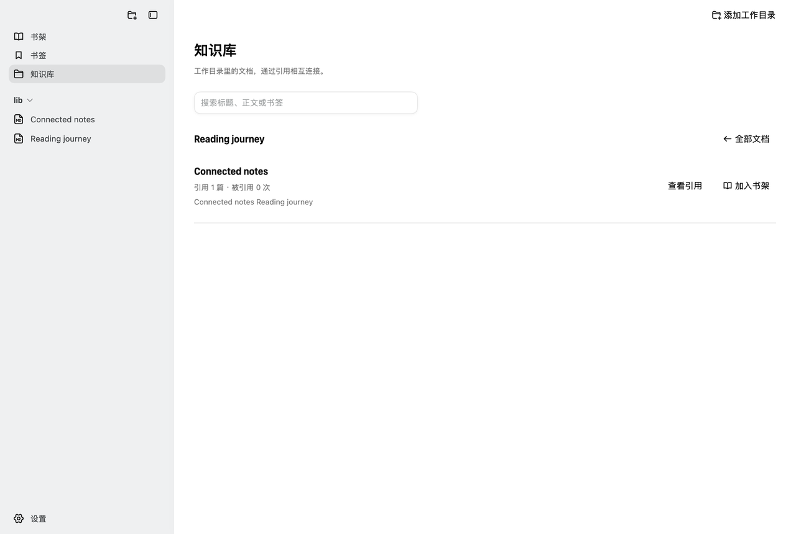

<p align="center"></p>
<h1 align="center">Readus.md</h1>
<p align="center"><b>A quiet place to read, return, and connect your knowledge.</b><br>A local reading and knowledge workspace built on Quiet.md, Rust and GPUI.</p>
<p align="center">English · <a href="README.zh-CN.md">简体中文</a></p>
<p align="center"><a href="https://github.com/LJL17378/readus-md/releases">Download test builds</a> · <a href="https://github.com/LJL17378/readus-md/actions/workflows/dev-build.yml">Development builds</a> · <a href="https://github.com/LJL17378/readus-md/issues">Feedback</a> · <a href="CONTRIBUTING.md">Contributing</a></p>

Readus.md adds a bookshelf, paragraph bookmarks, reading progress and a connected view of working-folder documents. It keeps the original app’s quiet typography, flat document surface and native editor. Your bookshelf and knowledge library refer to the same files; reading metadata does not insert tags into your Markdown or rich-document body.

This is a **test-stage fork**, based on [Quiet.md](https://github.com/s1dashu/quiet-md) 0.1.14. Test packages are published in **this repository’s Releases**. Upstream Quiet.md downloads do not contain these features.

## Download and install

Go to [Releases](https://github.com/LJL17378/readus-md/releases) and open the newest **Readus.md Test** prerelease. Prereleases are not shown by GitHub’s `/releases/latest` shortcut.

| Package | Platform | Install |
|---|---|---|
| `readus-dev-macos-arm64.dmg` | Apple Silicon Mac, macOS 13+ | Open and drag **Readus.md Dev.app** to Applications |
| `readus-dev.zip` | Same Mac build | Extract and move the app to Applications |
| `SHA256SUMS.txt` / `metadata.json` | Verification | Package checksums and exact source/build information |

The test app is ad-hoc signed and **not Apple-notarized**. macOS may ask for approval under System Settings → Privacy & Security on first launch. It includes the development test driver. A separate stable release has not been published. Windows, Intel Mac and Linux test installers are not yet available for this fork; CI coverage is not a claim of local validation on those systems.

Double-click launches use an independent library at `~/Library/Application Support/Readus.md Test/library`, with logs in the adjacent `logs` directory. Explicit `QUIET_MD_HOME` / `QUIET_MD_LOG_DIR` settings take precedence. Test editing on copies: opening a working folder uses its actual files.

GitHub **Packages** is not used for desktop installers. Actions **Artifacts** are temporary build outputs retained for seven days; Releases is the persistent user download entry.

## Read and return



- **Bookshelf:** All, To read, Reading and Finished; continue a recent document, remove it from the shelf without deleting it, or explicitly mark it finished.
- **Progress:** current location in the reader, furthest position on the bookshelf, and paragraph-based restoration after reopening. Progress estimates position, not comprehension.
- **Bookmarks:** add the current or selected passage with ⌘D, jump from the document drawer or global bookmarks page, and remove bookmarks. Anchors use passage text and context; missing or ambiguous passages keep their bookmarks and explain the problem.
- **Knowledge library:** browse open working folders, search documents, and follow related documents through @mentions, ordinary Markdown file links and backlinks. It does not create a second copy of your library.
- **Languages and appearance:** the new reading UI supports Simplified Chinese and English and follows the existing light/dark design system. The app mark is a flat blue stack of books.



The inherited editor, Markdown support, rich documents, whiteboards and folder operations remain available. The source retains Quiet.md’s CLI/MCP integration, but **the current test package does not bundle the `quiet` CLI**. There is no built-in Agent chat yet. Any future embedded Agent must ship with provider, endpoint, model, secure API-key management and a connection test; see [the reading guide](docs/READING.md).

## Develop and test

The supported workflow for a disk-constrained Mac is **GitHub Actions compilation → verified download → isolated local runtime tests**. No local Rust or Xcode installation is required for that workflow.

```sh
./scripts/dev.sh doctor
./scripts/dev.sh pull <successful-development-run-id>
./scripts/dev.sh run       # isolated manual preview
./scripts/dev.sh stop
./scripts/dev.sh test      # synthetic documents, restart and bookmark checks
READUS_TEST_LANG=zh ./scripts/dev.sh test
```

Downloads verify the repository, commit, run, architecture, checksum and signature before replacement. Old test bundles and download archives are removed after successful replacement. Only the current app and the newest three generated test reports are kept.

- [Reading guide](docs/READING.md) — bookshelf, bookmarks, progress and knowledge references.
- [Cloud build workflow](docs/development/CLOUD_BUILD.md) — development, debugging, CI and publishing a test package.
- [Architecture](docs/ARCHITECTURE.md) — GPUI UI and independent `fdl_core` document engine.
- [Contributing](CONTRIBUTING.md) — checks, data protection and release boundaries.

## Origin and license

Readus.md is a fork of [s1dashu/quiet-md](https://github.com/s1dashu/quiet-md), credited for the original app and document engine. `quiet_md`, `quiet`, `.quiet` and `QUIET_MD_*` remain technical names for compatibility, not alternate download products. Existing upstream release notes, performance reports, site and deployment scripts are historical/source material; they do not describe a published Readus.md service or installer.

Code is [MIT licensed](LICENSE). See [THIRD_PARTY.md](THIRD_PARTY.md) for asset and dependency licenses, including the Nucleo icon restrictions. Upstream Quiet.md branding is not granted by the code license; the current Readus.md icon has separate [artwork provenance](assets/branding/README.md).
