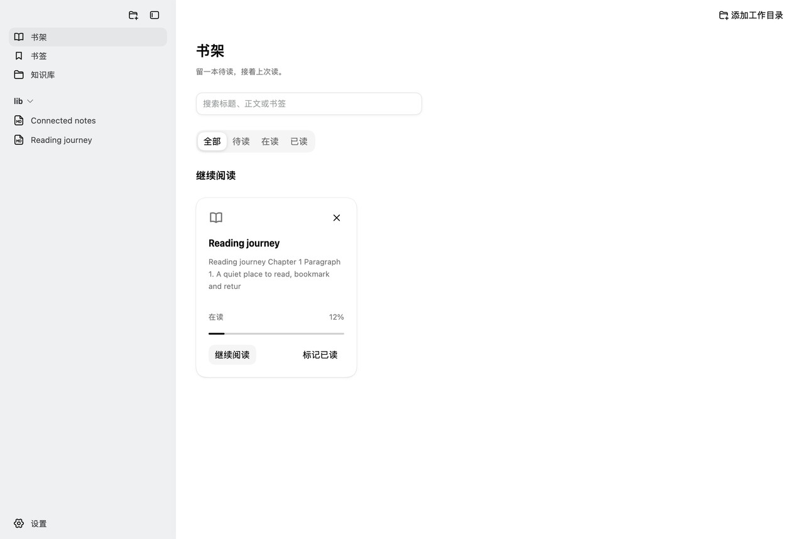
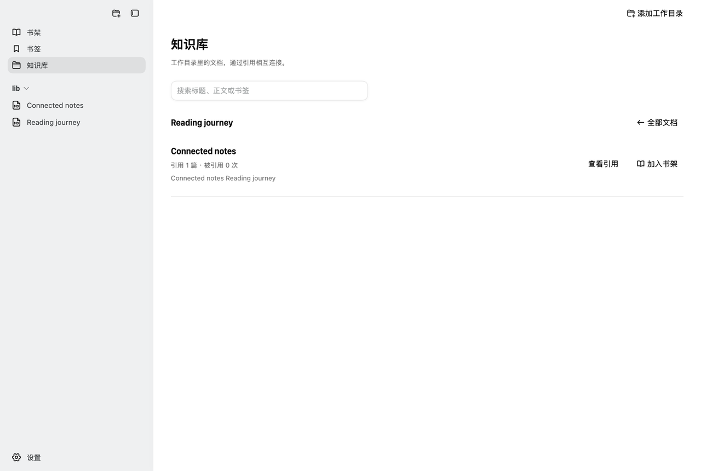

<p align="center"></p>
<h1 align="center">Readus.md</h1>
<p align="center"><b>安静阅读，随时续读，让文档彼此连接。</b><br>基于 Quiet.md、Rust 和 GPUI 的本地阅读与知识工作区。</p>
<p align="center"><a href="README.md">English</a> · 简体中文</p>
<p align="center"><a href="https://github.com/LJL17378/readus-md/releases">下载测试版</a> · <a href="https://github.com/LJL17378/readus-md/actions/workflows/dev-build.yml">开发构建</a> · <a href="https://github.com/LJL17378/readus-md/issues">问题反馈</a> · <a href="CONTRIBUTING.md">参与开发</a></p>

Readus.md 为原有编辑器加入书架、段落书签、阅读进度和基于工作目录的知识库。界面沿用原项目安静的排版、平整的文档表面和原生交互。书架与知识库使用同一批真实文件，阅读记录不会向 Markdown 或富文档正文插入专用标记。

当前为基于 [Quiet.md](https://github.com/s1dashu/quiet-md) 0.1.14 的**测试阶段分支项目**。请从**本仓库的 Releases** 下载；上游 Quiet.md 安装包不包含本次改造。

## 下载与安装

进入 [Releases](https://github.com/LJL17378/readus-md/releases)，打开最新的 **Readus.md Test** 预发布版。GitHub 的 `/releases/latest` 不包含预发布版，请使用这里的 Releases 列表入口。

| 文件 | 适用平台 | 安装方式 |
|---|---|---|
| `readus-dev-macos-arm64.dmg` | Apple Silicon Mac，macOS 13+ | 打开 DMG，将 **Readus.md Dev.app** 拖入 Applications 后启动 |
| `readus-dev.zip` | 同一个 Mac 测试版 | 解压，将应用拖入 Applications |
| `SHA256SUMS.txt`、`metadata.json` | 下载核对 | 校验值、源码提交与构建信息 |

测试版使用 ad-hoc 签名，**尚未完成 Apple Developer ID 签名与公证**；首次打开可能需要在系统设置 → 隐私与安全性中确认。包内启用了开发测试驱动，当前没有正式稳定版。Windows、Intel Mac、Linux 的本轮测试安装包尚未发布，CI 编译覆盖不代表已在这些设备上完成人工验证。

双击启动默认使用独立文档库 `~/Library/Application Support/Readus.md Test/library`，日志在同级 `logs` 目录。显式指定 `QUIET_MD_HOME` 或 `QUIET_MD_LOG_DIR` 时，使用指定路径。添加工作目录会直接使用目录中的文件，测试编辑请先准备副本。

GitHub **Packages** 不用于发布这里的桌面安装包。Actions 的 **Artifacts** 是保留七天的临时构建输出；**Releases 才是用户下载入口**。

## 阅读、续读与知识整理



- **书架**：全部、待读、在读、已读；最近在读可以继续阅读，移出书架保留原文和阅读记录，完成阅读后主动标记已读。
- **阅读进度**：阅读页显示当前位置，书架记录读到的最远位置，重新打开按段落和段内位置恢复。百分比是位置估计，不代表理解程度。
- **书签**：使用 ⌘D 标记选中段落或当前位置，从文档书签栏、全局书签页跳转或移除。通过文字和上下文定位；原段落无法确定时保留书签并提示原因。
- **知识库**：汇集已打开的工作目录，搜索文档，通过 @文档引用、普通 Markdown 文件链接与反向引用查找关联文档，不再复制一套文件。
- **语言与外观**：新增阅读界面支持简体中文和英文，使用原有深浅色设计系统；应用图标采用蓝色平面叠书。



原有编辑器、Markdown、富文档、白板和文件夹操作继续保留。源码保留 Quiet.md 的 CLI/MCP 集成能力，但**当前测试包没有打包 `quiet` 命令行工具**。本轮没有内置 Agent 聊天功能；后续实现时必须同时提供服务商、接口地址、模型、API 密钥安全管理和连接测试，详见[阅读工作区说明](docs/READING.md)。

## 开发与测试

磁盘受限 Mac 的主要流程是：**GitHub Actions 编译 → 下载并验证构建 → 本机隔离运行与调试**。这条流程不需要在本机安装 Rust 或 Xcode。

```sh
./scripts/dev.sh doctor
./scripts/dev.sh pull <成功的开发构建编号>
./scripts/dev.sh run       # 在隔离文档库中手动体验
./scripts/dev.sh stop
./scripts/dev.sh test      # 合成文档、重启恢复、书签回归
READUS_TEST_LANG=zh ./scripts/dev.sh test
```

下载时核对仓库、提交、构建、架构、校验值和签名，通过后替换旧版本并删除旧应用及下载压缩包。只保留当前测试应用和最近三份合成数据测试报告。

- [阅读工作区说明](docs/READING.md)：书架、书签、进度和引用关系。
- [云端构建流程](docs/development/CLOUD_BUILD.md)：开发、调试、CI 与测试版发布。
- [架构](docs/ARCHITECTURE.md)：GPUI 界面与独立的 `fdl_core` 文档引擎。
- [贡献指南](CONTRIBUTING.md)：检查要求、数据保护和发布边界。

## 来源与许可

本项目衍生自 [s1dashu/quiet-md](https://github.com/s1dashu/quiet-md)，原应用与文档引擎归功于上游贡献者。为兼容现有数据和工具，保留 `quiet_md`、`quiet`、`.quiet`、`QUIET_MD_*` 等技术名称。仓库中原有发布记录、性能报告、网站与部署脚本属于上游历史或源码材料，不代表 Readus.md 已发布对应服务或安装包。

代码采用 [MIT 许可证](LICENSE)。第三方依赖、字体及图标许可见 [THIRD_PARTY.md](THIRD_PARTY.md)，其中 Nucleo 图标有独立限制。代码许可不授予上游 Quiet.md 品牌使用权；Readus.md 当前图标的来源见[图标说明](assets/branding/README.md)。
